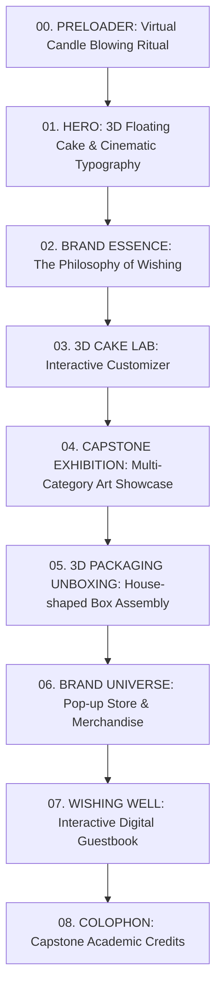

# 🎂 WISHES — CAPSTONE PROJECT SHOWCASE WEBSITE
### Đồ Án Tốt Nghiệp Ngành Thiết Kế Mỹ Thuật Số (Digital Art & Design)
**Sinh viên thực hiện:** Nguyễn Hồng Thu Phương (PHUONGNHT8)  
**Mã đồ án:** `GFA26GD60` | Fall 2026 | FPT University  
**Slogan / Tagline:** *"MAKE A WISH. TAKE A BITE"*  
**Phong cách nghệ thuật:** 3D Surrealism • Whimsical Pastry • Harajuku Sweetcore • Editorial Elegance  

---

## 📌 MỤC LỤC
1. [Tổng Quan Đồ Án & Brand Strategy](#1-tổng-quan-đồ-án--brand-strategy)
2. [Art Direction & Hệ Thống Nhận Diện Thị Giác](#2-art-direction--hệ-thống-nhận-diện-thị-giác)
3. [Catalog Tài Nguyên Đã Trích Xuất (Assets Directory)](#3-catalog-tài-nguyên-đã-trích-xuất-assets-directory)
4. [Kiến Trúc Kỹ Thuật & Yêu Cầu Kỹ Năng (Skills)](#4-kiến-trúc-kỹ-thuật--yêu-cầu-kỹ-năng-skills)
   - [Three.js / WebGL Skills (3D Surrealism)](#41-threejs--webgl-skills-3d-surrealism)
   - [GSAP 3 & ScrollTrigger Skills (Motion Design)](#42-gsap-3--scrolltrigger-skills-motion-design)
   - [Motion Design & Micro-Interactions](#43-motion-design--micro-interactions)
5. [Cấu Trúc Trang Web & Kịch Bản Trải Nghiệm (UX/UI Breakdown)](#5-cấu-trúc-trang-web--kịch-bản-trải-nghiệm-uxui-breakdown)
6. [Bộ Master Prompt Khởi Tạo Web (Dành Cho AI Coder)](#6-bộ-master-prompt-khởi-tạo-web-dành-cho-ai-coder)
7. [Mã Nguồn Mẫu (Implementation Code Starters)](#7-mã-nguồn-mẫu-implementation-code-starters)

---

## 1. TỔNG QUAN ĐỒ ÁN & BRAND STRATEGY
*(Toàn bộ thông tin được tổng hợp trực tiếp từ hồ sơ gốc `GFA26GD60_PHUONGNHT8_Wishes__Proposal0.pdf`)*

* **Tên thương hiệu:** **WISHES**
* **Mô hình kinh doanh:** Boutique Pastry — cửa hàng bánh ngọt cao cấp mang tính trải nghiệm, kết hợp giữa không gian Pop-up store vật lý và nền tảng đặt hàng trực tuyến số hóa.
* **Hình mẫu thương hiệu (Brand Archetype):** Sự kết hợp giữa **The Innocent** (thuần khiết, mộc mạc, ngọt ngào) và **The Magician / The Creator** (kỳ ảo, sáng tạo, biến điều ước thành hiện thực).
* **Định vị thị trường (Brand Positioning):**
  * Tọa độ: **Artisanal / Creative** kết hợp **Playful** (vượt trội so với các tiệm bánh công nghiệp đại trà thiếu cảm xúc và tiệm bánh truyền thống rập khuôn).
  * Triết lý: Mỗi chiếc bánh không chỉ là món ăn mà là một điều ước được thổi nến, một khoảnh khắc kỳ diệu đánh thức cảm xúc.
* **Khách hàng mục tiêu (Target Audience):**
  * Độ tuổi: 18 – 30 tuổi (Gen Z và người trẻ tại các đô thị lớn như TP.HCM, Hà Nội).
  * Nghề nghiệp: Sinh viên, Designer, Freelancer, Creative Professionals, tiếp viên hàng không, người yêu thích nghệ thuật thẩm mỹ.
  * Tâm lý & Hành vi (Persona Insight): Tìm kiếm sự cá nhân hóa, yêu thích phong cách dễ thương, ngộ nghĩnh, trân trọng nét quyến rũ bất toàn (*"Embracing Imperfection / Wonky charm"*).
* **Danh mục sản phẩm cốt lõi (Product Line):**
  1. **Celebration Cakes:** Bánh kem sinh nhật đặc biệt (10cm, 12cm, 14cm, 16cm, 20cm, 24cm) với các vị Signature: Cheesecake, Tiramisu, Red Velvet.
  2. **Daily Baked Goods:** Bánh tươi thủ công mỗi ngày gồm Cinnamon Roll (quế phủ kem vani/chocolate), Cookie (Chocochip, Matcha, Oatmeal), Egg Tart Custard, Croissant ngàn lớp giòn xốp.

---

## 2. ART DIRECTION & HỆ THỐNG NHẬN DIỆN THỊ GIÁC

### 2.1. Visual Aesthetic: 3D Surreal Sweetcore & Playful Whimsy
* **Cảm hứng nghệ thuật:** Không gian siêu thực ngọt ngào (*Pastel Dreamscape*), kết hợp tính nghịch ngợm của phong cách Harajuku Y2K và sự chỉn chu tinh tế của nghệ thuật bánh ngọt thủ công Pháp (*French Artisanal Craftsmanship*).
* **Đặc trưng thị giác:**
  * Những chiếc bánh bất đối xứng đáng yêu (*Wonky cakes*), kem chảy tự nhiên, quả cherry bóng bẩy, nơ lụa thắt hoa văn, phụ kiện kẹo ngọt phóng đại (muỗng nĩa khổng lồ, đám mây kem bồng bềnh).
  * Mascot & Đồ họa phụ trợ: Các ngôi sao lấp lánh (sparkles), trái tim cách điệu, linh vật chú mèo/thỏ thần tiên cầm hoa tulip.

### 2.2. Bảng Màu Thương Hiệu (Color Palette)
| Tên Màu | Mã HEX | Vai Trò & Ứng Dụng |
|---|---|---|
| **Cotton Candy Pink** | `#FFB6C1` / `#FFAEC9` | Màu thương hiệu chủ đạo, xuất hiện ở bao bì, nút bấm tương tác, ánh sáng rim-light 3D |
| **Pastel Baby Blue** | `#BDE0FE` / `#A0C4FF` | Màu nền canvas, sọc sọc dù che pop-up (awning stripes), logo Wishes |
| **Fresh Mint Green** | `#BEE3DB` / `#C1F0DC` | Màu điểm nhấn phụ trợ, tạo cảm giác tươi mới (*freshness*), nhãn dán tem |
| **Butter Whipped Cream** | `#FFF9E6` / `#FDFAF2` | Màu nền đọc chữ (Background base), tạo cảm giác ấm áp (*warmth*) của bột bánh vừa nướng |
| **Rich Chocolate Brown** | `#4A2E1B` / `#3D2314` | Màu chữ chính (Typography), viền outline đồ họa, đảm bảo độ tương phản cao |
| **Cherry Gloss Red** | `#E63946` / `#FF3366` | Màu điểm nhấn hút mắt (Call-to-action, quả cherry trên bánh, thông báo sale) |

### 2.3. Hệ Thống Kiểu Chữ (Typography Hierarchy)
* **Display / Headline Font:** Custom Swash Serif hoặc Retro Bubbly Cursive mang nét uốn lượn cổ tích (tương đồng với font *"Wishes"* và *"CONCEPT & STYLE"* trên trang 66-67). Gợi ý font Web: `IvyMode`, `Recoleta`, `Praise`, hoặc `Fraunces` với biến thể Soft/Wonky.
* **Secondary / Subheading Font:** Rounded Bold Sans-Serif mang tính nghịch ngợm, thân thiện: `Fredoka`, `Comfortaa`, hoặc `Cabinet Grotesk`.
* **Body / UI Font:** Tối ưu hóa đọc chữ mượt mà trên màn hình số: `Plus Jakarta Sans`, `Inter`, hoặc `Be Vietnam Pro` (hỗ trợ tiếng Việt hoàn hảo).

---

## 3. CATALOG TÀI NGUYÊN ĐÃ TRÍCH XUẤT (ASSETS DIRECTORY)
Tất cả 161 hình ảnh gốc và 28 slide thuyết trình chất lượng cao (150 DPI) đã được trích xuất trực tiếp từ file PDF gốc vào hệ thống thư mục:

### 3.1. Cấu Trúc Thư Mục
```
c:\Users\ADMIN\Downloads\NEN FILE PDF\
├── assets\
│   ├── extracted_images\    # 161 tệp ảnh nguyên bản (raw raster assets)
│   └── rendered_pages\      # 28 slide thuyết trình thiết kế độ phân giải cao
├── assets_manifest.json     # Tệp JSON định nghĩa metadata của toàn bộ 189 tài nguyên
└── README.md                # Tài liệu kỹ thuật dự án (tệp hiện tại)
```

### 3.2. Bảng Liên Kết Các Ảnh Trọng Tâm Cần Dùng Cho Website

#### A. Concept Art & Moodboard (Slide & Raw Images)
* **Slide tổng quan Art Direction:** [`public/assets/rendered_pages/slide_p66_art_direction___concept_and_style_m.png`](public/assets/rendered_pages/slide_p66_art_direction___concept_and_style_m.png)  
  *Ý nghĩa:* Thể hiện thế giới quan kẹo ngọt siêu thực, model tóc hồng, nĩa khổng lồ, bánh jelly cherry.
* **Ảnh nhân vật & concept chụp thực tế:**
  * [`public/assets/extracted_images/p66_01_art_direction___concept_and_st.png`](public/assets/extracted_images/p66_01_art_direction___concept_and_st.png) — Chân dung model với mũ bánh kem & nơ ren.
  * [`public/assets/extracted_images/p66_02_art_direction___concept_and_st.png`](public/assets/extracted_images/p66_02_art_direction___concept_and_st.png) — Model tương tác với chiếc nĩa khổng lồ giữa xứ sở bánh kem.
  * [`public/assets/extracted_images/p66_03_art_direction___concept_and_st.png`](public/assets/extracted_images/p66_03_art_direction___concept_and_st.png) — Bàn tiệc bánh ngọt siêu thực với bánh thạch hoa quả và cherry.
  * [`public/assets/extracted_images/p66_04_art_direction___concept_and_st.png`](public/assets/extracted_images/p66_04_art_direction___concept_and_st.png) — Poster triển lãm Neo-End Fantasy.
  * [`public/assets/extracted_images/p66_05_art_direction___concept_and_st.png`](public/assets/extracted_images/p66_05_art_direction___concept_and_st.png) — Model nấp sau bàn bánh cupcake sắc màu.
  * [`public/assets/extracted_images/p66_06_art_direction___concept_and_st.png`](public/assets/extracted_images/p66_06_art_direction___concept_and_st.png) — Model bên tháp bánh kem sinh nhật công chúa.

#### B. Logo & Typography Identity
* **Slide hệ thống Logo:** [`public/assets/rendered_pages/slide_p67_art_direction___logo_design.png`](public/assets/rendered_pages/slide_p67_art_direction___logo_design.png)
* **Chi tiết logo typography & hiệu ứng 3D Candy:**
  * [`public/assets/extracted_images/p67_01_art_direction___logo_design.png`](public/assets/extracted_images/p67_01_art_direction___logo_design.png) — Lưới phác thảo cấu trúc logo uốn lượn trái tim.
  * [`public/assets/extracted_images/p67_02_art_direction___logo_design.png`](public/assets/extracted_images/p67_02_art_direction___logo_design.png) — Các biến thể logo hoa văn sao lấp lánh (Sparkle variations).
  * [`public/assets/extracted_images/p67_03_art_direction___logo_design.png`](public/assets/extracted_images/p67_03_art_direction___logo_design.png) — Wordmark "Wishz" phong cách 3D Candy Puff hồng ngọt ngào.
  * [`public/assets/extracted_images/p67_04_art_direction___logo_design.png`](public/assets/extracted_images/p67_04_art_direction___logo_design.png) — Wordmark "What if" hiệu ứng viền nổi xanh pastel và trái tim.

#### C. Website UI Proposal (Bản Phác Thảo Gốc Của Tác Giả)
* **Slide mockup giao diện web tác giả đề xuất:** [`public/assets/rendered_pages/slide_p69_art_direction___website_mockup.png`](public/assets/rendered_pages/slide_p69_art_direction___website_mockup.png)
* **Chi tiết màn hình:**
  * [`public/assets/extracted_images/p69_01_art_direction___website_mockup.png`](public/assets/extracted_images/p69_01_art_direction___website_mockup.png) — Phân hệ **Interactive Cake Customizer** ("Làm bánh cùng SS" - tùy chọn dáng tròn/trái tim, kích thước, số tầng).
  * [`public/assets/extracted_images/p69_02_art_direction___website_mockup.png`](public/assets/extracted_images/p69_02_art_direction___website_mockup.png) — Phân hệ **Boutique Bakery Canopy Store** (Mái che lều sọc sọc, biển hiệu marquee, kệ trưng bày bánh signature).

#### D. Packaging & Unboxing System (Hệ Thống Bao Bì)
* **Slide bao bì toàn diện:** [`public/assets/rendered_pages/slide_p74_packaging_system.png`](public/assets/rendered_pages/slide_p74_packaging_system.png)
* **Từng kiểu dáng bao bì sáng tạo:**
  * [`public/assets/extracted_images/p74_01_packaging_system.png`](public/assets/extracted_images/p74_01_packaging_system.png) — Hộp bánh ngôi nhà cổ tích có quai xách ruy-băng (*House-shaped pastry box*).
  * [`public/assets/extracted_images/p74_02_packaging_system.png`](public/assets/extracted_images/p74_02_packaging_system.png) — Hộp quà hình lều mái tam giác sọc xanh neon phá cách.
  * [`public/assets/extracted_images/p74_03_packaging_system.png`](public/assets/extracted_images/p74_03_packaging_system.png) — Hộp bánh kem có cửa sổ nhìn thấy bánh bên trong (*Window display pastry house*).
  * [`public/assets/extracted_images/p74_04_packaging_system.png`](public/assets/extracted_images/p74_04_packaging_system.png) — Bộ sưu tập hộp chóp nón cụt hình trụ màu pastel.
  * [`public/assets/extracted_images/p74_05_packaging_system.png`](public/assets/extracted_images/p74_05_packaging_system.png) — Hộp kéo ngăn trượt cao cấp phong cách Bakes.
  * [`public/assets/extracted_images/p74_06_packaging_system.png`](public/assets/extracted_images/p74_06_packaging_system.png) — Set bao bì quà tặng kết hợp túi giấy và phụ kiện nơ.

#### E. Merchandise & Quà Tặng Đồ Án
* **Slide huy hiệu & phụ kiện cài áo:** [`public/assets/rendered_pages/slide_p83_merchandise___enamel_pins_and_badge.png`](public/assets/rendered_pages/slide_p83_merchandise___enamel_pins_and_badge.png)
  * [`public/assets/extracted_images/p83_01_merchandise___enamel_pins_and_.png`](public/assets/extracted_images/p83_01_merchandise___enamel_pins_and_.png) — Huy hiệu kim loại men tráng bóng hình bánh kem & mascot.
  * [`public/assets/extracted_images/p83_02_merchandise___enamel_pins_and_.png`](public/assets/extracted_images/p83_02_merchandise___enamel_pins_and_.png) — Bộ pin cài áo nơ và trái tim.
* **Slide ruy-băng trang trí:** [`public/assets/rendered_pages/slide_p84_merchandise___ribbons_and_packaging.png`](public/assets/rendered_pages/slide_p84_merchandise___ribbons_and_packaging.png)
  * Trích xuất các dải ruy-băng in họa tiết Wishes: [`public/assets/extracted_images/p84_01_merchandise___ribbons_and_pack.png`](public/assets/extracted_images/p84_01_merchandise___ribbons_and_pack.png) đến [`public/assets/extracted_images/p84_08_merchandise___ribbons_and_pack.png`](public/assets/extracted_images/p84_08_merchandise___ribbons_and_pack.png).
* **Slide vương miện sinh nhật giấy:** [`public/assets/rendered_pages/slide_p85_merchandise___birthday_hat_and_crow.png`](public/assets/rendered_pages/slide_p85_merchandise___birthday_hat_and_crow.png).
* **Khăn Bandana:** Trang 82 trong PDF.

#### F. Bộ Sưu Tập Sản Phẩm (Product Photography)
* **Bánh sinh nhật & Bánh kem:**
  * [`public/assets/rendered_pages/slide_p58_product_line___celebration_cak.png`](public/assets/rendered_pages/slide_p58_product_line___celebration_cak.png)
  * [`public/assets/rendered_pages/slide_p59_celebration_cakes___big_and_small.png`](public/assets/rendered_pages/slide_p59_celebration_cakes___big_and_small.png)
* **Bánh ngọt hàng ngày (Daily Pastry):**
  * [`public/assets/rendered_pages/slide_p60_daily_baked_goods___cinnamon_roll_c.png`](public/assets/rendered_pages/slide_p60_daily_baked_goods___cinnamon_roll_c.png)
  * Cinnamon Roll: [`public/assets/extracted_images/p61_01_product___cinnamon_roll_pricin.png`](public/assets/extracted_images/p61_01_product___cinnamon_roll_pricin.png)
  * Cookie (Set 3 vị): [`public/assets/extracted_images/p62_01_product___cookie_pricing.png`](public/assets/extracted_images/p62_01_product___cookie_pricing.png)
  * Egg Tart Custard: [`public/assets/extracted_images/p63_01_product___egg_tart_pricing.png`](public/assets/extracted_images/p63_01_product___egg_tart_pricing.png)
  * Croissant bơ Pháp: [`public/assets/extracted_images/p64_01_product___croissant_pricing.png`](public/assets/extracted_images/p64_01_product___croissant_pricing.png)

#### G. Nhận Diện Văn Phòng & Cửa Hàng (Store & Stationery)
* **Bộ nhận diện văn phòng (Stationery Set):** [`public/assets/rendered_pages/slide_p71_brand_collateral___stationery_set.png`](public/assets/rendered_pages/slide_p71_brand_collateral___stationery_set.png)
* **Đồng phục nhân viên (Staff Uniform):** [`public/assets/rendered_pages/slide_p72_brand_collateral___staff_uniform.png`](public/assets/rendered_pages/slide_p72_brand_collateral___staff_uniform.png)
* **Lót ly & khăn ăn giấy (Placemat & Napkin):**
  * [`public/assets/rendered_pages/slide_p76_brand_collateral___placemat.png`](public/assets/rendered_pages/slide_p76_brand_collateral___placemat.png)
  * [`public/assets/rendered_pages/slide_p78_brand_collateral___napkin.png`](public/assets/rendered_pages/slide_p78_brand_collateral___napkin.png)
* **Brochure giới thiệu:** [`public/assets/rendered_pages/slide_p80_marketing___brochure_design.png`](public/assets/rendered_pages/slide_p80_marketing___brochure_design.png)
* **Không gian cửa hàng Pop-up store:** [`public/assets/rendered_pages/slide_p96_wishes_project_overview___archetype.png`](public/assets/rendered_pages/slide_p96_wishes_project_overview___archetype.png) (Ảnh quầy bar terrazzo pastel, kệ gỗ vòm cung, đèn lồng phong cách Parisian Chic).

---

## 4. KIẾN TRÚC KỸ THUẬT & YÊU CẦU KỸ NĂNG (SKILLS)

Website phải được xây dựng đạt chuẩn cao cấp của **Awwwards Site of the Day / FWA**, thể hiện đẳng cấp đồ án tốt nghiệp ngành Mỹ thuật Số (*Digital Art & Design*).

### 4.1. Three.js / WebGL Skills (3D Surrealism Hybrid Architecture)
Website áp dụng mô hình **Hybrid 3D Architecture**:
1. **Trục Xương Sống 3D Xuyên Suốt (Full-Viewport Persistent 3D Canvas):**
   * Hoạt động như lớp nền WebGL liên tục trải dài từ đầu đến cuối trang web.
   * Khi cuộn trang (Scroll-driven Animation), camera 3D di chuyển mượt mà qua các tọa độ không gian vũ trụ bánh ngọt lơ lửng (*Pastel Dreamscape*).
   * **Hiệu ứng Post-Processing cao cấp:**
     - **UnrealBloom mộng ảo:** Tạo hào quang phát sáng êm dịu quanh ngọn nến và bánh kem.
     - **Jelly Glass Chromatic Refraction:** Mô phỏng khúc xạ ánh sáng qua các khối thạch dẻo và thủy tinh đường.
     - **Triple-Point Pastel Rim Lighting:** Đánh sáng viền màu hồng pastel (`#FFAEC9`) và xanh baby (`#A0C4FF`) ôm lấy các khối bánh, tạo chiều sâu 3D điện ảnh.
2. **Phân Khu Tương Tác 1 — "3D Cake Customizer Lab":**
   * Trục camera dừng tại bục trưng bày trung tâm, kích hoạt hệ thống điều khiển xoay 360 độ (OrbitControls).
   * Tùy biến thời gian thực: chuyển đổi dáng Tròn / Trái tim, kích thước 10cm - 24cm, bảng màu kem tươi, rắc hạt cốm, đặt cherry đỏ bóng và chọn kiểu dáng hộp bánh ngôi nhà 3D.
3. **Phân Khu Tương Tác 2 — "Exhibition Gallery & Artbook Flip":**
   * Sử dụng **Custom WebGL Liquid Ribbon Shader**: Khi hover vào các thẻ tác phẩm artbook, bề mặt ảnh gợn sóng biến chuyển mượt mà như dải lụa mềm hoặc lớp kem kem mịn.
   * Kết hợp **GSAP Flip Plugin**: Mở rộng ảnh thành modal chi tiết toàn màn hình ở tốc độ 60fps mượt mà tuyệt đối.

### 4.2. GSAP 3 & ScrollTrigger Skills (Motion Design)
1. **Lenis Smooth Scroll:** Đồng bộ cuộn trang siêu mượt với quán tính vật lý tự nhiên, loại bỏ cảm giác giật lag (*jitter-free*).
2. **Horizontal Storytelling Pinning:**
   * Tại phân đoạn câu chuyện thương hiệu (*Brand Story*), màn hình được ghim lại (`pin: true`), cuộn dọc sẽ chuyển thành cuộn ngang đưa người xem đi qua từng lát cắt ý niệm: *"From Personal Craving to Moments of Joy"*.
3. **SplitText Typography Reveal:**
   * Tiêu đề chính *"MAKE A WISH. TAKE A BITE"* và *"WISHES"* xuất hiện theo từng ký tự với độ trễ so le (`stagger: 0.04s`), kết hợp chuyển động nảy mềm mại (`ease: "back.out(1.7)"`) và hiệu ứng mờ nhòe nhẹ lúc khởi đầu.
4. **GSAP Flip Plugin (Seamless Modal Expansion):**
   * Khi nhấn vào một tác phẩm (hộp bánh, brochure, huy hiệu), thẻ phóng to toàn màn hình mượt mà không làm đứt đoạn ngữ cảnh duyệt web.

### 4.3. Motion Design & Micro-Interactions
1. **Interactive Custom Cursor:**
   * Con trỏ chuột hình giọt kem hoặc ngôi sao lấp lánh, tự động phóng to và biến thành chữ *"BITE ME"* hoặc *"WISH"* khi di chuột vào các vùng tương tác (`Magnetic Cursor`).
2. **Virtual Candle Blowing Ritual (Nghi Thức Thổi Nến Ước):**
   * Ở màn hình Preloader hoặc Footer: Người dùng click giữ chuột hoặc bật micro thổi nhẹ để ngọn nến 3D tắt đi, kích hoạt pháo hoa hạt lấp lánh (*Confetti Particle Explosion*) giải phóng website.
3. **Ambient Audio Soundscape:**
   * Nút bật/tắt âm thanh tinh tế góc màn hình: Âm thanh gió chuông mơ màng, tiếng thì thầm thổi nến và tiếng "ting" vui tai khi click chuột.

---

## 5. CẤU TRÚC TRANG WEB & KỊCH BẢN TRẢI NGHIỆM (UX/UI BREAKDOWN)



### Chi Tiết Từng Phân Đoạn:

#### 00. Preloader — The Dual-Input Wishing Candle Ritual
* **Trải nghiệm:** Màn hình tông màu cream ấm chuyển dần sang không gian huyền ảo. Một cây nến 3D lung linh giữa màn hình với lời mời gọi: *"Thổi nhẹ vào micro hoặc nhấn giữ để gửi một điều ước"*.
* **Tương tác Dual-Input:**
  - Cách 1: Thổi nhẹ vào Microphone (Web Audio API phân tích âm lượng thời gian thực).
  - Cách 2: Nhấn giữ chuột hoặc chạm màn hình 1.5 giây.
* **Hiệu ứng chuyển cảnh (Shimmer & Reveal):** Khi nến tắt, làn khói 3D chuyển hóa thành vụ nổ bụi sao **Shimmer / Confetti Particle Explosion** sắc màu pastel (`#FFB6C1`, `#FFF3B0`, `#BEE3DB`, `#A0C4FF`).
* **Wish Card Reveal:** Một tấm thiệp ước nguyện ngẫu nhiên xuất hiện kèm thông điệp may mắn ngộ nghĩnh (ví dụ: *"A sweet surprise is heading your way"*) trước khi tấm rèm mở màn đưa người dùng vào trang chủ.
* **Soundscape:** Tiếng thì thầm thổi nến, tiếng chuông gió lofi ngân nga và nút Audio Mute/Unmute cố định tinh tế ở góc màn hình.

#### 01. Hero Section — The Surreal Pastry Universe
* **Nền:** Three.js Canvas toàn màn hình với chiếc bánh kem Signature 3D bồng bềnh lơ lửng, chậm rãi xoay quanh trục Y.
* **Chữ:** Wordmark *"WISHES"* cỡ lớn hiển thị nổi bật với texture kẹo ngọt 3D, bên dưới là slogan *"MAKE A WISH. TAKE A BITE"*.
* **Call to Action:** Nút từ tính (*Magnetic Button*) viền bóng lượn sóng: *"Khám Phá Thế Giới Wishes"*.

#### 02. Story & Philosophy — Hành Trình Ra Đời
* **Kỹ thuật:** GSAP ScrollTrigger Ghim trang (Pinning).
* **Nội dung:** Đối chiếu sự đối lập giữa tiệm bánh công nghiệp vô cảm và thế giới Boutique Pastry ngập tràn cảm xúc.
* **Hình ảnh minh họa:** Kết nối trực tiếp slide định vị [`slide_p99_brand_positioning_map___whimsical_p.png`](public/assets/rendered_pages/slide_p99_brand_positioning_map___whimsical_p.png) và chân dung khách hàng Persona Thy & Hằng.

#### 03. 3D Cake Customizer Lab — Phòng Thí Nghiệm Bánh Ngọt
* **Kế thừa bản vẽ gốc:** Chuyển đổi ý tưởng trang 69 [`p69_01_art_direction___website_mockup.png`](public/assets/extracted_images/p69_01_art_direction___website_mockup.png) thành mô hình 3D tương tác sống động:
  * **Hình dáng bánh:** Tròn (Round) / Trái tim (Heart-shaped).
  * **Kích thước:** 10cm (Cá nhân) đến 24cm (Đại tiệc).
  * **Topping:** Gắp thả dâu tây, cherry đỏ bóng, nến số, rắc hạt cốm.
  * **Xuất bộ đôi quà tặng số "The Viral Keepsake & Aesthetic Receipt":**
    1. **Tấm thiệp WISHES Card chuẩn tỷ lệ 9:16:** Bắt góc camera 3D đẹp nhất (Beauty Shot) của chiếc bánh vừa custom, phủ nền gradient pastel, tên người nhận và lời chúc viết tay bay bổng để tải về hoặc chia sẻ tức thì lên Instagram Stories / TikTok.
    2. **Hóa đơn cảm xúc nghệ thuật (Aesthetic Pop-up Receipt):** Mô phỏng giấy in nhiệt tiệm bánh boutique theo xu hướng thiết kế Gen Z, liệt kê các "nguyên liệu cảm xúc" (100% Niềm tin, 1 thìa Hy vọng, Vị dâu ngọt ngào...) và có mã QR độc bản dẫn ngược lại phiên bản 3D của chính chiếc bánh đó trên website.

#### 04. Capstone Portfolio Exhibition — Không Gian Triển Lãm Đồ Án
Bố cục Grid phá cách bất đối xứng (*Bento Grid*) phân loại các hạng mục tốt nghiệp:
1. **Brand Identity:** Logo sketches, Typography, Brand Guideline ([`slide_p67_art_direction___logo_design.png`](public/assets/rendered_pages/slide_p67_art_direction___logo_design.png)).
2. **Concept Art & Photography:** Bộ ảnh nghệ thuật siêu thực model tóc hồng ([`slide_p66_art_direction___concept_and_style_m.png`](public/assets/rendered_pages/slide_p66_art_direction___concept_and_style_m.png)).
3. **Packaging System:** Hệ thống hộp bánh ngôi nhà, hộp ngăn kéo, chóp nón ([`slide_p74_packaging_system.png`](public/assets/rendered_pages/slide_p74_packaging_system.png)).
4. **Merchandise & Collaterals:** Huy hiệu men bóng, ruy-băng in hoa văn, vương miện giấy ([`slide_p83_merchandise___enamel_pins_and_badge.png`](public/assets/rendered_pages/slide_p83_merchandise___enamel_pins_and_badge.png), [`slide_p84_merchandise___ribbons_and_packaging.png`](public/assets/rendered_pages/slide_p84_merchandise___ribbons_and_packaging.png)).
5. **Store Design:** Kiến trúc quầy bánh Pop-up Store phong cách lều sọc sọc vintage ([`slide_p96_wishes_project_overview___archetype.png`](public/assets/rendered_pages/slide_p96_wishes_project_overview___archetype.png)).

#### 05. 3D Packaging Unboxing Experience & Dieline Engineering
Trải nghiệm bao bì được thiết kế 2 tầng tương tác điện ảnh:
* **Tầng 1 — Trình Diễn Mở Hộp Điện Ảnh (Scroll-linked Origami Unboxing):**
  - Khi cuộn trang đến khu vực Packaging, camera 3D khóa vị trí (sticky) tập trung vào mô hình chiếc **hộp bánh ngôi nhà 3D** ([`p74_01_packaging_system.png`](public/assets/extracted_images/p74_01_packaging_system.png)).
  - Cuộn chuột kích hoạt hoạt cảnh: Nơ ruy-băng lụa tự động nới lỏng nút thắt, hai cánh mái vòm mở tung sang hai bên.
  - Khay bánh signature và các món merchandise (huy hiệu kim loại tráng men [`p83_01_merchandise___enamel_pins_and_.png`](public/assets/extracted_images/p83_01_merchandise___enamel_pins_and_.png), khăn bandana gấp nghệ thuật) trồi lên nhẹ nhàng với hiệu ứng nổi khối 3D mềm mại.
* **Tầng 2 — Chế Độ Soi Chi Tiết & Bản Vẽ Cấn Bế Dieline Blueprint (Vũ Khí Ăn Điểm Hội Đồng):**
  - **Chế độ 360° Showroom:** Cho phép rê chuột xoay tự do mô hình 360 độ; nhấp đúp vào từng ngăn bánh/hộp quà để kéo trượt ra xem chi tiết chất liệu (ép kim vàng bóng loáng, giấy mỹ thuật dập nổi vân nổi gân).
  - **Chế độ Engineering Blueprint / Dieline Switch:** Bấm nút chuyển đổi, mô hình 3D biến đổi mượt mà (morphing) xòe phẳng thành bản vẽ kỹ thuật trải phẳng 2D/3D hiển thị rõ đường cấn (crease lines), đường bế (cut lines), vùng dập nổi và thông số kích thước khuôn bế thực tế.

#### 06. Interactive Wishing Well — Cổng Gửi Điều Ước (Community Ribbon Galaxy)
* Khách truy cập nhập tên và điều ước của mình.
* Mỗi điều ước sau khi gửi sẽ hóa thành một hạt sao lung linh bay vút lên hòa vào **Dải ngân hà ruy-băng** 3D uốn lượn mềm mại trên màn hình theo thời gian thực.
* Người xem có thể rê chuột vào từng ngôi sao trên dải ruy-băng để đọc những lời chúc ngọt ngào của cộng đồng gửi đến đồ án.

#### 07. Colophon & Academic Credits
* Thông tin bảo vệ đồ án tốt nghiệp:
  * **Sinh viên:** Nguyễn Hồng Thu Phương (PHUONGNHT8)
  * **Chuyên ngành:** Thiết kế Mỹ thuật Số (Digital Art & Design) — FPT University (Fall 2026)
  * **Mã hội đồng / Lớp:** GFA26GD60

---

## 6. BỘ MASTER PROMPT KHỞI TẠO WEB (DÀNH CHO AI CODER)

*Hãy sao chép nguyên văn khối lệnh dưới đây khi yêu cầu AI (như Claude 3.7 Sonnet, Gemini 1.5 Pro, GPT-4o, v0 hoặc Cursor) xây dựng mã nguồn:*

````markdown
### MASTER PROMPT: AWWWARDS-GRADE CREATIVE SHOWCASE WEBSITE FOR "WISHES" CAPSTONE

You are a World-Class Creative Technologist and Lead Frontend Engineer (Awwwards Site of the Year Winner).
Your mission is to engineer the showcase website for the Graduation Capstone Project in Digital Art & Design:
"WISHES" by student Nguyen Hong Thu Phuong (PHUONGNHT8 - Capstone Code: GFA26GD60 - Fall 2026 - FPT University).

Core Philosophy: **VISUAL BEAUTY & ARTISTIC EXCELLENCE RANKED #1** (Maximum aesthetic fidelity, dreamy pastel post-processing, 60fps organic animations).
Target Environment: Dedicated ARM Ampere A1 Server (4 OCPU, 24 GB RAM, 200 GB Storage) — ample headroom for high-res assets, SSR, and rich WebGL runtimes.

Brand Essence & Tagline: "MAKE A WISH. TAKE A BITE"
Art Direction: 3D Surrealism, Harajuku Wonky Sweetcore, Pastel Dreamscape, Parisian Boutique Pastry Chic.
Color Palette:
- Soft Candy Pink: #FFB6C1 / #FFAEC9
- Pastel Baby Blue: #BDE0FE / #A0C4FF
- Mint Cream Green: #BEE3DB / #C1F0DC
- Butter Whipped Cream: #FFF9E6 / #FDFAF2
- Rich Chocolate Brown: #4A2E1B / #3D2314
- Glossy Cherry Red: #FF3366 / #E63946

Technical Stack:
- Framework: Next.js (App Router, TypeScript)
- Styling: Tailwind CSS (with extended pastel design tokens)
- Smooth Scroll: Lenis (@studio-freight/lenis)
- Motion & Animation: GSAP 3 (ScrollTrigger, Flip, SplitText)
- 3D WebGL Engine: Three.js via @react-three/fiber and @react-three/drei
- Postprocessing: @react-three/postprocessing (UnrealBloom, ChromaticAberration)
- Audio Engine: Howler.js for ambient lofi soundscape and tactile interaction sound FX
- Asset Manifest: Refer to `assets_manifest.json` referencing `/public/assets/extracted_images/` and `/public/assets/rendered_pages/`.

Core Architectural & UX Deliverables:
1. DUAL-INPUT PRELOADER & WISHING CANDLE RITUAL:
   - Interactive 3D candle flame extinguished via either real-time microphone blowing detection (Web Audio API) or 1.5-second mouse/touch press.
   - Flame extinguishing triggers procedural pastel smoke morphing into a dazzling Shimmer/Confetti particle explosion.
   - Reveals a randomized, whimsical fortune "Wish Card" before sliding open the curtain into the main world.
   - Persistent ambient audio toggle (Mute/Unmute) with gentle lofi wind chimes and whisper sound FX.
2. FULL-VIEWPORT PERSISTENT 3D WORLD SPINE:
   - Continuous WebGL background canvas with scroll-driven camera flight across pastel clouds, floating surreal pastry geometries, and jelly gems.
   - Triple-point rim lighting (#FFAEC9 pink, #A0C4FF blue, #FFF5EA warm key) and selective bloom glow.
3. 3D CAKE CUSTOMIZER LAB (Hyper-Tactile Haute Pâtisserie & Baking Blueprint):
   - Real-time 3D cake builder with 360° orbital controls: toggle Round vs Wonky Heart geometry, adjust scale (10cm-24cm), pick artisanal frosting colors with food-grade Pantone identifiers.
   - Procedural Vintage Lambeth Shell Piping (viền ren sò hoàng gia uốn lượn 3D quanh chân và miệng bánh).
   - Realistic Ruby Cherry with curved green stem, indentation, and transparent dew water droplets.
   - Interactive 3D Cutaway Mode (Bóc Tách Mặt Cắt 3D): Hiển thị kết cấu 4 tầng cốt bánh thực tế (Gateau Vani, Mousse Dâu, Gelée Cherry-Việt quất, Mascarpone Chantilly) kèm thông số milimet và mã màu Pantone để thợ làm bánh có thể thi công thực tế 1:1.
   - Triple Export:
     a) "WISHES Card" (9:16 Instagram Story image generator with 3D beauty shot, user name, and handwritten wish).
     b) "Aesthetic Pop-up Receipt" (Thermal-printed boutique receipt listing emotional ingredients and a unique QR code linking back to the interactive 3D cake model).
     c) "Baking Production Spec Sheet" (Hồ sơ kỹ thuật gia công bánh ngọt dành cho thợ làm bánh).
4. CAPSTONE EXHIBITION BENTO GRID & ARTBOOK FLIP:
   - Multi-category portfolio display (Brand Identity, Concept Art, Packaging, Merchandise, Pop-up Store).
   - Custom WebGL liquid ribbon ripple shader on hover mimicking soft whipped cream/jelly waves.
   - GSAP Flip plugin for 60fps seamless card expansion into fullscreen inspection modals.
5. 2-TIER 3D PACKAGING UNBOXING & DIELINE BLUEPRINT:
   - Tier 1: True 3D WebGL House-shaped Box Mesh (Slide 74) — cinematic 3-stage unboxing with satin ribbon untying, rooftop flaps unfolding outwards, and inner tray ascending with signature cake and gold enamel pins.
   - Tier 2: Interactive Dieline Technical Blueprint Mode — chuyển đổi sang bản vẽ kỹ thuật cấn bế vector 2D/3D chuyên nghiệp với bộ lọc các lớp Đường Cắt Bế (Cut Line), Đường Cấn Gập (Crease Line), Vùng Ép Kim Nhũ Vàng 24K (Gold Foil Mask), và thước đo kích thước mở khổ 580 × 440mm.
6. CELESTIAL MOBIUS RIBBON GALAXY (WISHING WELL GUESTBOOK):
   - Không gian 3D ngân hà dải lụa Möbius xoắn vô tận trong Three.js WebGL với các tinh cầu pha lê phát sáng đại diện cho lời chúc cộng đồng.
   - Tương tác nhấp vào tinh cầu 3D để phóng to đọc lời chúc, kèm âm hưởng chuông pha lê ngân vang qua Web Audio API synthesis.
   - Nghi thức gửi điều ước phóng tinh cầu sao và nổ pháo hoa ngũ sắc lấp lánh.
7. ACADEMIC COLOPHON & CREDITS:
   - Clear academic graduation credits for student Nguyen Hong Thu Phuong (PHUONGNHT8 - GFA26GD60 - Fall 2026 - FPT University).
````

---

## 7. MÃ NGUỒN MẪU (IMPLEMENTATION CODE STARTERS)

### 7.1. Cấu Hình Khung Dự Án (Project Setup)
```bash
# Khởi tạo dự án Next.js hiện đại
npx create-next-app@latest wishes-showcase --typescript --tailwind --eslint --app

# Cài đặt các thư viện chuyển động và đồ họa 3D chuẩn quốc tế
npm install three @types/three @react-three/fiber @react-three/drei
npm install gsap @studio-freight/lenis lucide-react canvas-confetti howler
npm install -D @types/canvas-confetti @types/howler
```

### 7.2. Three.js Floating Pastry Canvas (React Three Fiber)
```tsx
// components/Hero3DCanvas.tsx
"use client";
import React, { useRef } from "react";
import { Canvas, useFrame } from "@react-three/fiber";
import { Float, MeshDistortMaterial, Sphere, Torus, Center } from "@react-three/drei";
import * as THREE from "three";

function FloatingCake() {
  const groupRef = useRef<THREE.Group>(null);

  useFrame((state) => {
    if (!groupRef.current) return;
    const t = state.clock.getElapsedTime();
    groupRef.current.rotation.y = t * 0.3;
    groupRef.current.position.y = Math.sin(t * 0.8) * 0.15;
  });

  return (
    <group ref={groupRef}>
      {/* Tầng bánh đế (Base Layer) */}
      <mesh position={[0, -0.6, 0]} castShadow receiveShadow>
        <cylinderGeometry args={[2, 2, 0.8, 48]} />
        <meshStandardMaterial color="#FFF9E6" roughness={0.3} metalness={0.05} />
      </mesh>

      {/* Lớp kem phủ mộng mơ (Icing layer) */}
      <mesh position={[0, -0.15, 0]}>
        <cylinderGeometry args={[1.5, 1.5, 0.8, 48]} />
        <MeshDistortMaterial color="#FFAEC9" speed={1.5} distort={0.12} roughness={0.2} />
      </mesh>

      {/* Quả cherry trên đỉnh (Glossy Red Cherry) */}
      <Float speed={2} rotationIntensity={0.5} floatIntensity={0.5}>
        <Sphere args={[0.3, 32, 32]} position={[0, 0.65, 0]}>
          <meshPhysicalMaterial color="#FF3366" roughness={0.1} clearcoat={1.0} clearcoatRoughness={0.1} />
        </Sphere>
      </Float>
    </group>
  );
}

export default function Hero3DCanvas() {
  return (
    <div className="absolute inset-0 z-0 pointer-events-none">
      <Canvas camera={{ position: [0, 1.5, 5], fov: 45 }}>
        <ambientLight intensity={0.9} />
        <directionalLight position={[5, 8, 5]} intensity={1.5} color="#FFF5EA" castShadow />
        <pointLight position={[-4, 2, -2]} intensity={2.0} color="#A0C4FF" />
        <FloatingCake />
      </Canvas>
    </div>
  );
}
```

### 7.3. Đồng Bộ GSAP ScrollTrigger & Lenis Smooth Scroll
```typescript
// hooks/useSmoothScroll.ts
"use client";
import { useEffect } from "react";
import Lenis from "@studio-freight/lenis";
import { gsap } from "gsap";
import { ScrollTrigger } from "gsap/ScrollTrigger";

export function useSmoothScroll() {
  useEffect(() => {
    gsap.registerPlugin(ScrollTrigger);

    const lenis = new Lenis({
      duration: 1.2,
      easing: (t) => Math.min(1, 1.001 - Math.pow(2, -10 * t)),
      orientation: "vertical",
      smoothWheel: true,
    });

    lenis.on("scroll", ScrollTrigger.update);

    gsap.ticker.add((time) => {
      lenis.raf(time * 1000);
    });

    gsap.ticker.lagSmoothing(0);

    return () => {
      lenis.destroy();
      ScrollTrigger.getAll().forEach((trigger) => trigger.kill());
    };
  }, []);
}
```

---

## 8. HƯỚNG DẪN DÀNH CHO CÁC HỆ THỐNG AI KHÁC (NOTE FOR AGENTS)
* Tệp tin này đóng vai trò là **Single Source of Truth** (nguồn chân lý độc nhất) cho dự án *Wishes*.
* Bất kỳ AI trợ lý nào tham gia vào dự án tiếp theo hãy đọc trực tiếp `README.md`, `PROJECT_MEMORY.md`, và tệp `assets_manifest.json` để xác định chính xác đường dẫn ảnh, bảng màu, typography và ngữ cảnh đồ án tốt nghiệp của sinh viên Nguyễn Hồng Thu Phương mà không cần hỏi lại các thông số nền tảng.
* Toàn bộ tài nguyên ảnh trong thư mục `public/assets/` đều đã được kiểm tra tính toàn vẹn (integrity) và liên kết tương thích 100% với đề cương đồ án.

---

## 9. HƯỚNG DẪN TRIỂN KHAI THỰC THI (LOCAL & ARM AMPERE A1 SERVER)

### 9.1. Khởi Chạy Tại Môi Trường Local (Windows / macOS / Linux)
```bash
# 1. Cài đặt các gói phụ thuộc
npm install

# 2. Khởi chạy máy chủ phát triển (Dev Server)
npm run dev
# Truy cập giao diện tại: http://localhost:3000

# 3. Kiểm tra kiểm thử biên dịch tĩnh (Production Build)
npm run build
npm run start
```

### 9.2. Triển Khai Trên Máy Chủ ARM Ampere A1 (4 OCPU / 24 GB RAM / 200 GB SSD)
Cấu hình máy chủ ARM64 cực mạnh cho phép xử lý streaming WebGL, SSR và tối ưu hoá tài nguyên hình ảnh ở tốc độ tối đa:

```bash
# Clone repository bảo mật
git clone https://github.com/hannhu11/Wishes-branding.git
cd Wishes-branding

# Cài đặt Node.js v20+ / v22+ trên Ubuntu ARM64
npm install

# Build ứng dụng với kiến trúc ARM tối ưu hóa
npm run build

# Khởi chạy daemon với PM2 Cluster Mode (tận dụng trọn vẹn 4 OCPU)
npm install -g pm2
pm2 start npm --name "wishes-showcase" -i max -- start
pm2 save
pm2 startup
```

### 9.3. Cấu Hình Nginx Đảo Ngược (Reverse Proxy) & Chứng Chỉ SSL
```nginx
server {
    listen 80;
    server_name wishes.yourdomain.com;
    return 301 https://$host$request_uri;
}

server {
    listen 443 ssl http2;
    server_name wishes.yourdomain.com;

    ssl_certificate /etc/letsencrypt/live/wishes.yourdomain.com/fullchain.pem;
    ssl_certificate_key /etc/letsencrypt/live/wishes.yourdomain.com/privkey.pem;

    # Gzip / Brotli nén tài nguyên 3D & hình ảnh
    gzip on;
    gzip_types text/plain text/css application/json application/javascript text/xml application/xml image/svg+xml;

    location / {
        proxy_pass http://127.0.0.1:3000;
        proxy_http_version 1.1;
        proxy_set_header Upgrade $http_upgrade;
        proxy_set_header Connection 'upgrade';
        proxy_set_header Host $host;
        proxy_cache_bypass $http_upgrade;
    }
}
```

---

## 10. BẢO MẬT GITHUB & TIÊU CHUẨN ĐA THIẾT BỊ (RESPONSIVE)

### 10.1. Quy Chuẩn An Toàn & Bảo Mật Quốc Tế (DevSecOps)
* **Tuyệt đối không đẩy lên Git:** Các khóa cá nhân (`*.pem`, `*.key`), tệp biến môi trường (`.env*`), tệp não bộ (`PROJECT_MEMORY.md`), thông tin cấu hình SSH, tệp file PDF gốc dung lượng lớn (>100MB).
* **Kiểm tra `.gitignore`:** Đã cấu hình đa tầng bảo vệ toàn diện, ngăn chặn hoàn toàn rò rỉ dữ liệu nhạy cảm ra kho mã nguồn công khai/riêng tư.
* **Commit Convention:** Tuân thủ chuẩn Conventional Commits (`feat:`, `fix:`, `docs:`, `style:`, `refactor:`, `perf:`).

### 10.2. Quy Chuẩn Trải Nghiệm Đa Nền Tảng (Cross-Device Guarantee)
* **Desktop (1440px - 1920px+):** Hiển thị đầy đủ con trỏ chuột nghệ thuật nam châm (`MagneticCursor`), hiệu ứng âm thanh Synthesizer Lofi, tương tác WebGL 3D 60fps mượt mà, layout Bento Grid 3-4 cột.
* **Tablet / iPad (768px - 1024px):** Lưới bố cục tự động chuyển sang 2 cột, hỗ trợ thao tác chạm đa điểm (`Touch gesture`), tối ưu hóa số lượng hạt confetti và giảm nhẹ tải GPU.
* **Mobile / Smartphone (375px - 430px):** 
  - Khóa con trỏ chuột ảo để chuyển sang cử chỉ vuốt chạm tự nhiên.
  - Bộ điều khiển tùy biến bánh 3D chuyển thành ngăn kéo trượt dưới màn hình (`Bottom Drawer / Sheet UI`).
  - Nút thổi nến chuyển đổi linh hoạt: vừa có micro vừa có nút ấn giữ trực quan.
  - Thẻ chia sẻ xuất ảnh tỷ lệ chuẩn `9:16` sẵn sàng đăng tải trực tiếp lên Instagram Story / TikTok.

